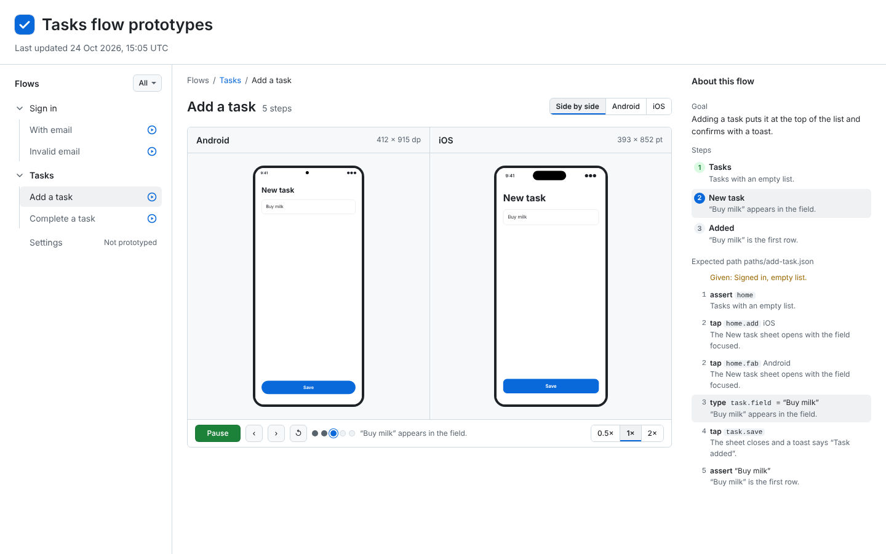

# Review pages: the flow-board pattern

**Version 1.2** · see [CHANGELOG.md](CHANGELOG.md) · worked example: [assets/example.html](assets/example.html) (open it in a browser), with its expected paths in [assets/paths/](assets/paths/)



A portable recipe for review pages that compare an app's **expected** behaviour with what it **actually** does on device. It grew out of one product's device-test flow board and flow prototypes. Any project can adopt it. Nothing here depends on any one product's code: copy the pattern, not another product's screens or files.

## The two pages

| Page | Shows | Built from |
| --- | --- | --- |
| **Flow board** (actual) | Each flow's latest device-test result per platform: verdict, end screenshot, recording, last pass, suspect changes | the CI device-test run's report |
| **Flow prototypes** (expected) | Each flow as a clickable, autoplaying mock on each platform, with the steps a test should check | hand-written source in the app repo |

Both pages use the same layout and the same flow names, so a reviewer reads them as a pair. Later they can be merged so each flow shows its expected and actual side by side.

## Layout (both pages)

1. **Left sidebar:** a fixed-height column that scrolls on its own: the "Flows · All" row stays put and only the list scrolls, while the page header scrolls away with the page. The flows are nested. A **parent** (a group, or a flow with edge cases) opens a list page of its children, like the board. A **child** opens the flow itself. Edge cases are children of their flow, never checkboxes. Each leaf shows a status icon: pass, fail or not run on the board, and prototyped on the prototypes.
2. **Centre:** a title row with the Side by side / Android / iOS switch on the right. Under it is one media box: a well per platform with each phone at its logical size and both scaled to the **same height**, and a **player bar** attached under the wells. The bar holds Play, back, forward, restart and the speed segment together, then the step dots, with the current expect line on its own row underneath at every width. The controls live with the media they drive.
3. **Right rail:** "About this flow": **Goal** (what the flow is for, in a sentence), the **Steps** (each says what you should see, written as a test assertion; clicking one jumps both phones) and the **Expected path**. The board adds the verdict, the run link, the last pass and the suspect PRs. A parent page shows "About this group" with its goal only.

Keep status colours for status. The current step and selected rows use the neutral `--selected` fill with a blue (`--accent`) number, never yellow, which means "attention". Label pills are for status only (Passed, Failed). Device sizes are plain muted text in the card header. Label screens that the OS draws (pickers, permission prompts, keyboards).

## Visual system: the flow board's Primer look

Both pages use the same chrome, taken from a production flow board (a public reference: `May-Assistant/may-releases` `tools/may_release/board_template.html`), which is built on GitHub Primer tokens and components. Don't restyle it per project. Copy the `<style>` block of [assets/example.html](assets/example.html) as-is. Only the app under test, inside the phones, keeps its own look.

| Part | What it is |
| --- | --- |
| Tokens | Primer colours as CSS variables (`--canvas`, `--canvas-subtle`, `--fg`, `--fg-muted`, `--border`, `--accent`, `--selected`, `--success`, `--danger`, `--attention` and their `-bg` pairs), with light and dark values and the system font stack. |
| Header | The app icon (32 px, 8 px radius), a 26 px semibold title and a meta line that says only "Last updated <date>, <time> UTC", then a full-width bottom rule. |
| Sidebar | 280 px wide with a right rule. A "Flows" heading with an **All ▾** filter button. Items are 6 px-radius rows with a 16 px status icon on the right. **Parent and child nesting:** a parent row has a chevron that turns when open. Its children sit behind a 1 px rule under the chevron, with their text aligned to the parent's text (no extra inset). The current item gets the `--selected` fill. Unbuilt flows say "Not prototyped" in muted text. |
| Main | Breadcrumbs (`Flows / Group / Flow`): links stay `--fg-muted` and underlined (never accent blue), and the group links back to its list page. Then a 22 px title with a muted tally and the platform switch on the right. Then one media box: per-platform wells, each with a grey header (the platform name, plus its size as muted text) and a grey well holding the phone, joined to the player bar. A parent page shows a Primer list of its children instead (status icon, name, tally). |
| Player bar (prototypes) | Attached under the wells: a green **Play** button, icon buttons for back, forward and restart, the 0.5×/1×/2× speed segment beside them, then clickable step dots (done, current, to come). The current step's expect line sits on its own row underneath. |
| Rail | 240–300 px wide with the heading "About this flow", then dt/dd pairs: **Goal**, **Steps** (numbered circles; the current step uses the `--selected` fill with a blue number, done steps green) and **Expected path** (each path step's action, its `code` target id and its expect line, with the current one in `--selected`). |
| Status icons | 16 px circles: green tick for pass, red cross for fail, empty circle for none, yellow triangle for switched off, and a blue play circle for prototyped. |

## Autoplay and touch indicators

- A **Play** button walks the flow on both phones at once, at a readable pace, with Pause and Reset.
- Every tap shows a **touch indicator**: a circle that stays about 1 s and then fades. Use the same style as the device recordings' touch overlay, so expected and actual look alike.
- Autoplay uses the same step list the rail shows, so what plays is what is checked.

## Expected paths (machine-readable)

Each prototype writes `paths/<flow>.json`, the path a test agent is expected to take:

```json
{
  "flow": "chat",
  "steps": [
    { "n": 2, "platform": "both", "action": "tap", "target": { "text": "Alex" },
      "expect": "Alex's chat opens.", "step": "opened" },
    { "n": 4, "platform": "android", "action": "tap", "target": { "id": "composer.field" },
      "expect": "The keyboard rises; the composer sits right on it.", "step": "keyboard" }
  ]
}
```

- `action` is one of `tap`, `type`, `wait` or `assert`.
- `target.id` is the platform's real test id. If no id exists, use `target.text`.
- `platform` is `both`, `ios` or `android`. When the platforms differ, write one entry per platform with the same `n`.
- Optional fields:
  - `value` for `type`;
  - `edge` for an error or edge branch;
  - `given` for the setup the step needs;
  - `unconfirmed: true` when the id or behaviour hasn't been checked against the app yet.

Device-test flows can be checked against these files: the test should tap the same targets in the same order and assert the same `expect` lines.

### Optional path fields (1.2)

- `board`: the flow's id on the flow board (its flow-list id, such as `"2"`), so the board can match a path without a lookup table.
- `scenario`: the device-test scenario that drives this flow.
- `cases`: a list of runs (`id`, `name`, `goal`, `start`, `given`), with `main` for the main path. Edge-case steps carry `edge: <case id>`.
- `screen` per step: an expected screenshot, at `screens/<flow>/<platform>/<n>.png`. Better: render it on demand (see below).
- Caps: at most 200 steps per path and 160 characters per `expect`.

### Deep links and screenshots (1.2)

Each prototype page opens on any step: `<flow>.html#n=<n>&platform=<ios|android>[&case=<id>]`. It runs the path to that step with autoplay off, stops every timer and animation, then sets `<html data-ready="1">`. Add `&shot=1` to render only the device screen at its logical size (for example Android 412 × 915 and iOS 393 × 852), with no page chrome, so a headless browser can screenshot each step with the network blocked. The flow board uses these to draw the expected screen next to each recording.

## Source of truth and publishing

- **Prototypes:** the source lives in the app repo, in one folder with `src/` and `dist/`. A build script turns the source into self-contained HTML pages, and committed source must rebuild `dist/` exactly.
- **Board:** CI generates it, and nobody edits it by hand.
- **Publishing:** each page is published once to a stable URL (for example, private claude.ai artifacts), and every later change goes to that same URL. A doc in the app repo lists each URL, where the page is built from, and how to republish it. May's is `may-app/docs/engineering/artifacts.md`.
- **Keeping it in step:** copy strings, step order and test ids from the app source, and colours and sizes from the design system's tokens. When a PR changes a flow's strings, steps or ids, update the prototype in the same PR or open a follow-up.

## Rules

- No secrets, test-account credentials or production data on any page.
- Use simple drawn stand-ins for brand marks and mascots, and label them as stand-ins.
- Each prototype lists its open questions. An open question is not a decision until someone decides it.

## Adopting it in another project

1. Write the project's flow list: numbered flows, each mapped to its device-test rows.
2. Build the prototypes for the most important flows first, using this layout, autoplay and `paths/` format.
3. Have CI write the board from each device run, with the same sidebar and flow numbers.
4. Publish both pages to stable URLs and list them in the project's artifacts doc.
5. Point the project's routine or coordinator prompt at that artifacts doc.

## Reference implementations

| What | Where |
| --- | --- |
| Minimal example (this skill) | [assets/example.html](assets/example.html) and [assets/paths/](assets/paths/): a sample app with two flows, nested groups and an edge case, and no dependencies |
| A production flow board (public) | `May-Assistant/may-releases`: `tools/may_release/board.py` and `board_template.html` |

## How changes cascade

This skill is the only source of the pattern. Projects adopt a version of it and never edit their own copy of the rules.

1. **Propose upstream.** When feedback in any project changes the pattern, that project's session opens a PR to this skill. The PR updates `README.md`, `example.html` and `paths/` together, bumps the version and adds a `CHANGELOG.md` entry. Feedback that is about one project's content only (its flows, copy or brand) stays in that project.
2. **Version.** A minor version (1.1) adds something optional, so projects can adopt it whenever they like. A major version (2.0) changes the layout, the `paths/` format or a rule, and every adopter must migrate.
3. **Pin.** Each adopting project records the version it follows next to its artifact list. For example, `docs/engineering/artifacts.md`. Trove uses its own equivalent.
4. **Pull.** Each project's routine or coordinator compares its pinned version with `CHANGELOG.md` here. When it is behind, it opens a PR in its own repo that adopts the change and bumps the pin, then republishes its pages to the same URLs.
5. **Conflicts.** If two projects want different things, the pattern grows an option, never a fork. The project's human director decides between options.
